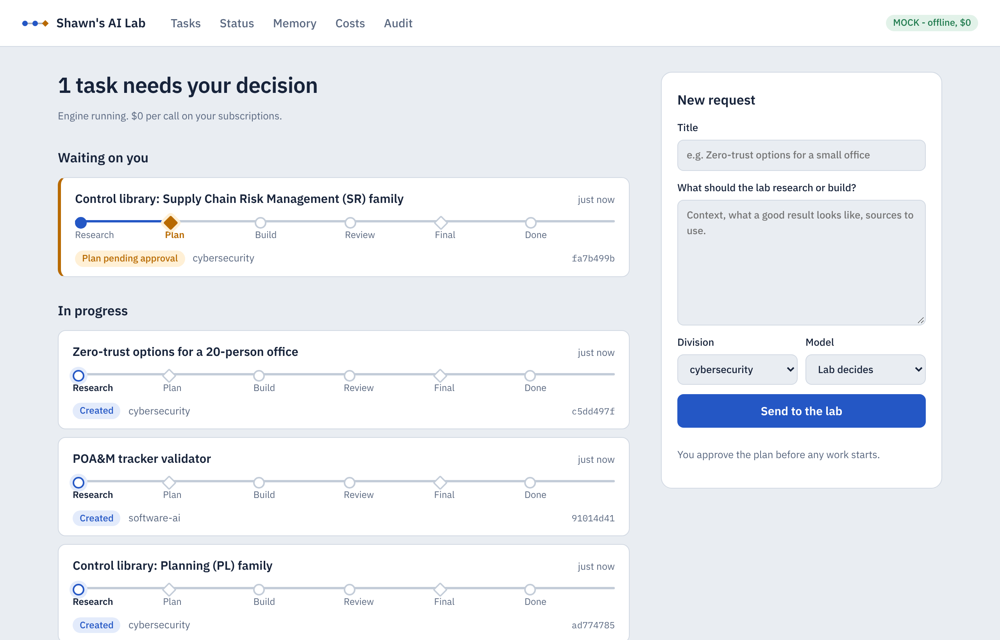
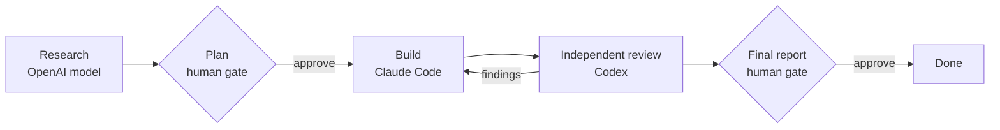
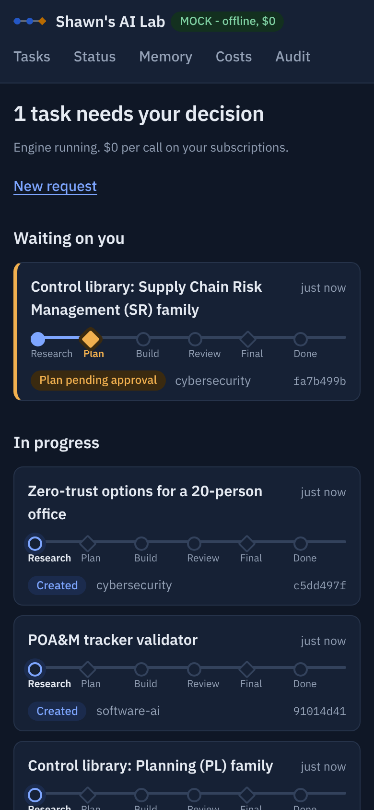

# Multi-Agent Research Lab

A self-hosted platform where three AI agents research, build and review work together,
and a human approves every step that matters. I designed it, wrote its operating
charter and security requirements, and run it day to day on my own hardware.

This repository is a public overview. The source code is private; I am happy to walk
through it in an interview.

## What it does

A request (for example, "draft the Supply Chain Risk Management control family") moves
along a fixed line:

- **Research and architecture** come from an OpenAI model, **implementation** from
  Claude Code, and an **independent review** from Codex, so no model grades its own work.
- Agents **deliberate** before work starts: the builder can challenge the plan, for at
  most three recorded rounds. Disagreements that remain go to me, not to a coin flip.
- The reviewer's findings are tracked one by one until they are fixed or escalated.
- **Model routing** picks a standard or a thorough model tier per task (for example,
  compliance and crosswalk work goes to the thorough tier) and recommends a re-run
  when a standard run struggles.

## Security design

The lab can run code-writing agents unattended, so it is built to fail closed.

- **Human gates.** Plans and final reports need an explicit approval that is bound to
  the exact content shown, single-use and time-limited. Agents cannot approve anything.
- **Least privilege.** Every model call goes through one gateway that enforces an
  allowlist of models, a spending authorization and a budget. Agents run in restricted
  modes and never write to the host directly; their output lands in a sandbox for review.
- **Tamper-evident audit log.** Every decision, call and approval is written to a
  hash-chained log that can be verified end to end.
- **No exposure.** The dashboard listens only on the local machine. Remote access is
  through a private Tailscale network with identity-based sign-in, never the public
  internet.
- **Phone approvals.** A dedicated Telegram bot sends alerts and two-tap
  approve/reject buttons that are cryptographically signed and checked against the
  approval's content and my account.
- **Secrets** are entered through hidden prompts and never stored in configuration or
  printed. Spending stays at $0 by default: the lab runs on existing subscriptions,
  and paid API use needs a separate authorization.

## Phone access

I can check status, submit research requests in plain language through the Telegram
bot, and approve work from my phone. Chat can draft a request but only a signed tap
submits it.

## First real workload

The lab is producing the unified control library for my
[cybersecurity program documentation](https://github.com/sbsmith340/cybersecurity-program-library):
NIST SP 800-53 Rev. 5 Moderate controls crosswalked to CSF 2.0, ISO/IEC 27001:2022,
CIS Controls v8.1 and SP 800-171 Rev. 3.

A lesson from that work shaped the design: AI-drafted framework mappings were wrong
often enough (about a third of CSF, ISO and CIS links) that every mapping is
now regenerated from the publishers' own crosswalks, and the agents' drafts are checked
against them automatically.

## Built with

Python 3.11+, SQLite, a standard-library web server, GitHub Actions CI with linting and
an automated test suite of over 700 tests, macOS login items, Telegram Bot API and
Tailscale.
